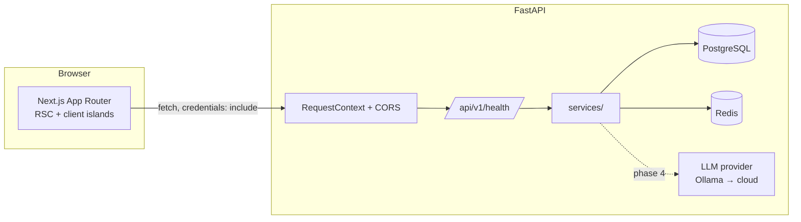

# Architecture

## 1. Shape of the system



The frontend never talks to PostgreSQL or a provider directly; every read and
write goes through the versioned API. WebSockets for live interviews arrive in
Phase 4 and follow the same auth rules as HTTP.

## 2. Frontend structure

| Path | Responsibility |
| --- | --- |
| `src/app/(marketing)/` | Public pages. Server components; no client fetch on load |
| `src/app/layout.tsx` | Fonts, metadata, providers. No page chrome |
| `src/components/ui/` | shadcn primitives. Do not fork these; override with `className` |
| `src/components/marketing/` | Section components composed from primitives + data |
| `src/components/layout/` | Header, footer, logo |
| `src/components/motion/` | Client-only animation wrappers (`Reveal`) |
| `src/components/typography/` | The only place the type scale is defined |
| `src/lib/marketing-data.ts` | All marketing copy, typed and unit-tested |
| `src/lib/api/client.ts` | Single fetch wrapper: cookies, JSON, `ApiError`, timeout |
| `src/config/site.ts` | Name, nav, footer, canonical URL |

Design decisions worth knowing:

- **Server-first.** Sections are server components. `Reveal` is the only client
  boundary in the marketing tree, and it renders children statically when the
  visitor prefers reduced motion, so content is never gated behind JS.
- **Content as data.** Copy lives in `marketing-data.ts` and is asserted in
  `src/lib/marketing-data.test.ts`, including a test that no fabricated social
  proof ("testimonials", "ratings", success rates) can sneak in.
- **No sticky header.** Sections keep their own scroll behaviour so scroll-driven
  animation can be added later without fighting a fixed element.

## 3. Design system

| Token group | Values |
| --- | --- |
| Ground | `--background #f2f4ff`, `--card #ffffff`, `--surface-sunken #e3ebf9` |
| Ink | `--foreground #13293d`, `--ink-70 #455a6e`, `--ink-50 #6b7f92` |
| Brand | `--primary #4338ca`, CTA gradient `#4f46e5 → #2563eb`, `--accent #006494` |
| Data / band | `--band #a9d3ff`, `--support #96c5f7` |
| Type | Kumbh Sans (UI), Share Tech Mono (timers, scores, level readouts) |
| Radius | cards 8px, fields 6px, chips 3–4px |

Tokens are declared once in `src/app/globals.css` under `:root`, mapped through
`@theme inline`, and consumed as Tailwind utilities (`bg-background`,
`text-ink-70`, `border-border`). Dark values are pre-wired under `.dark` but no
toggle ships yet.

## 4. Backend layering

```
api/v1/endpoints  → thin HTTP: status codes, response models
services          → domain logic, dependency probes
db                → async engine/session, declarative base
models            → SQLAlchemy tables
schemas           → Pydantic in/out contracts
core              → settings, logging, middleware
```

Conventions:

- **Optional infrastructure.** Empty `DATABASE_URL` / `REDIS_URL` is a valid
  state: health reports `configured: false` and returns 200 instead of crashing.
  This keeps tests, docs builds and first-run installs honest and fast.
- **Proxy failures, not successes.** A configured dependency that fails returns
  `503` with `status: "degraded"` and a short, non-sensitive detail string.
- **Deterministic constraints.** `MetaData(naming_convention=…)` so Alembic can
  name and drop constraints on Postgres.
- **One request id per request**, echoed in `x-request-id` and every error body.
- **Settings are typed and cached.** `get_settings()` is `lru_cache`d; tests pass
  an explicit `Settings` instance instead of mutating the environment.

## 5. Security posture

Implemented in Phase 1:

- Production boot guard: rejects default `SECRET_KEY`, `CORS=*`, `DEBUG=true`.
- Explicit CORS allow-list with credentials.
- Request ids for log correlation; secrets never logged.
- `.env` files git-ignored; `.env.example` holds placeholders only.
- Docs and OpenAPI disabled in production.

Deferred, tracked per phase:

- Password hashing, sessions, CSRF, rate limiting (Phase 2).
- Upload validation and private resume storage (Phase 6).
- Sandboxed code execution (Phase 7).
- Signed payment webhooks (Phase 9).

## 6. Phase map

| Phase | Scope | Status |
| --- | --- | --- |
| 1 | Architecture, design system, marketing site | **Done** |
| 2 | Auth, database models, onboarding | Next |
| 3 | Dashboard, interview setup, question bank | — |
| 4 | LLM integration, adaptive interview engine, WebSockets | — |
| 5 | Speech-to-text / text-to-speech | — |
| 6 | Resume upload, extraction, resume interviews | — |
| 7 | Monaco editor, isolated execution | — |
| 8 | Evaluation engine, reports, analytics | — |
| 9 | Plans, quotas, Razorpay | — |
| 10 | Admin, CMS, SEO tooling | — |
| 11 | Security audit, automated E2E, performance | — |
| 12 | Deployment, India-region hosting, backups | Partial (Docker + CI done) |
